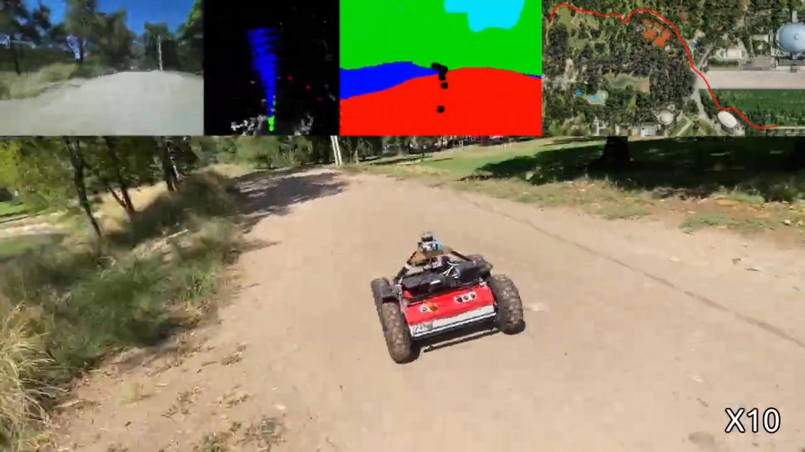
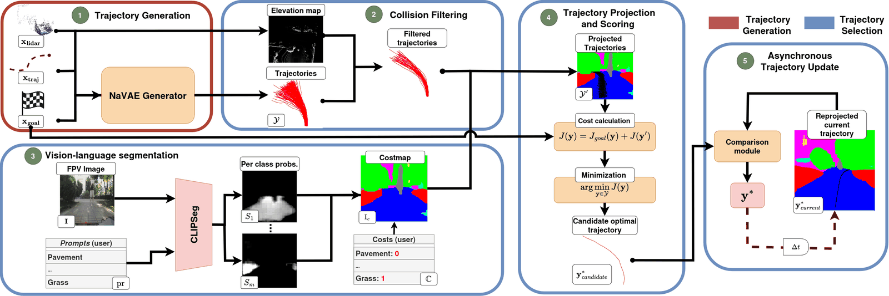
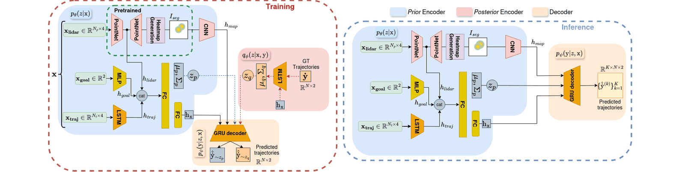
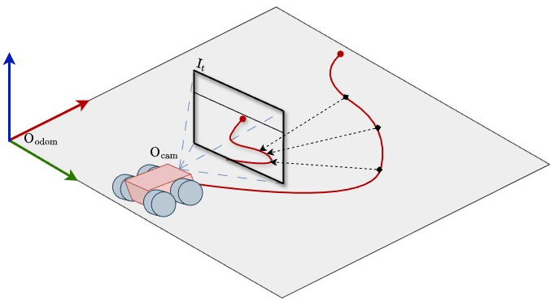
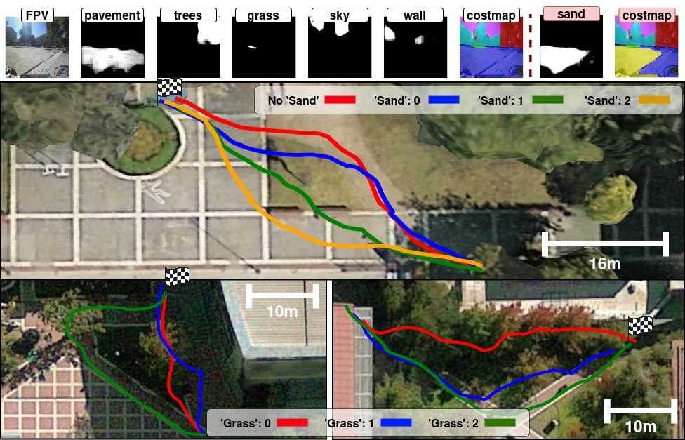
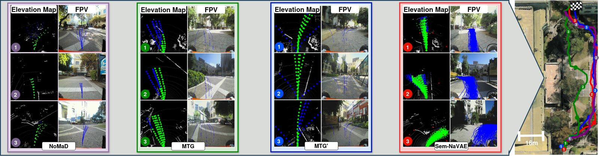
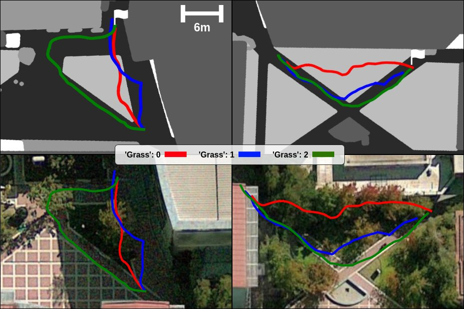
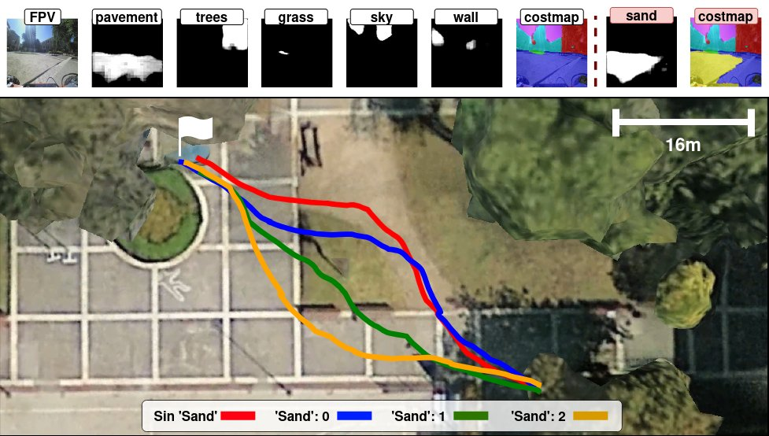
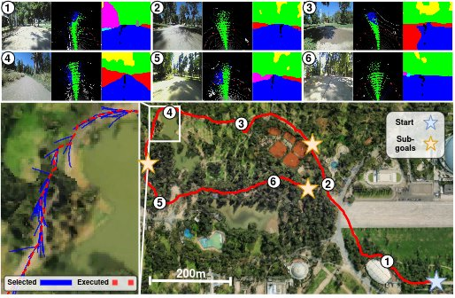

# Sem-NaVAE

**Semantically-Guided Outdoor Mapless Navigation via Generative Trajectory Priors**

Gonzalo Olguín, Javier Ruiz-del-Solar · *IEEE Robotics and Automation Letters*, 2026

[](LICENSE)
[](https://wiki.ros.org/noetic)
[](pyproject.toml)
[](https://youtu.be/i3R5ey5O2yk)



Sem-NaVAE is a mapless navigation approach for outdoor robots. A conditional variational
autoencoder (NaVAE) generates hundreds of geometrically feasible trajectories from LiDAR,
the past trajectory and a goal. A lightweight open-vocabulary segmentation model
(CLIPSeg) then scores them against user-defined terrain preferences given in natural
language, and an asynchronous update strategy decides when to switch the trajectory
being executed. In real-world outdoor experiments, Sem-NaVAE reaches a 90% success rate on
120–240 m routes in unseen environments.

🎥 [Video of an experimental run](https://youtu.be/i3R5ey5O2yk) · 📄 Paper: *link to be added on publication*

> [!WARNING]
> This repository is a cleaned-up and refactored version of the original research code
> used for the paper. The cleanup, refactoring and documentation were done with AI
> assistance (Claude Code) and reviewed by the author. **This version has not been tested
> on a real robot.** The results reported in the paper were obtained with the original
> code ([gonzal0lguin/NaVAE](https://github.com/gonzal0lguin/NaVAE)). The proprietary RL
> local planner used in the experiments is not included. **No pre-trained weights or
> datasets are released**: you need to train the models on your own data. Use at your own
> risk.

## Overview



1. **Trajectory generation.** NaVAE samples K = 200 trajectories from its learned prior,
   conditioned on three stacked LiDAR scans, the past trajectory and the goal in polar
   coordinates. A pre-trained PointNet segments the point cloud into traversable and
   non-traversable points. Its output is rasterised into a heatmap that constrains the
   GRU decoder while it samples velocities.
2. **Collision filtering.** Trajectories whose pitch between consecutive waypoints on an
   elevation map exceeds a threshold are discarded.
3. **Vision-language segmentation.** CLIPSeg segments the camera image with one prompt
   per class. Each pixel takes the user-assigned cost of its most likely class.
4. **Projection and scoring.** The trajectories are projected into the image. Each one
   gets a discounted semantic cost (unseen or occluded waypoints get a fixed cost) plus a
   goal cost, and the cheapest becomes the candidate.
5. **Asynchronous update.** The executing trajectory is re-projected and re-scored as new
   images arrive. A candidate replaces it only if it is cheaper by a margin ε.



| Trajectory projection | Changing the class costs changes the selected route |
|---|---|
|  |  |

<details>
<summary>Results from the paper</summary>



| Grass cost variation | Sand cost variation |
|---|---|
|  |  |



</details>

## Repository layout

| Path | Content |
|------|---------|
| `sem_navae/` | ROS-free Python package: NaVAE model, losses, data loading, training, inference, trajectory selection (`sem_navae/selection`) |
| `configs/` | Training (`train/navae.yaml`) and selection (`selection/default.yaml`) defaults, with the paper's values |
| `scripts/` | `train.py`, `pretrain_pointnet.py`, `sample.py`, `make_synthetic_dataset.py` |
| `ros/sem_navae_ros/` | ROS 1 (Noetic) package: generator, selector and visualizer nodes, elevation collision filter (C++), local planner plugins |
| `docs/` | [Paper ↔ code map](docs/paper_to_code.md), [errata](docs/errata.md), [dataset format](docs/dataset_format.md), [local planner plugins](docs/local_planner.md) |
| `tests/` | Unit tests, regression tests and a training smoke test |

## Installation

The core package needs Python ≥ 3.8 and PyTorch:

```bash
git clone https://github.com/gonzal0lguin/Sem-NaVAE.git
cd Sem-NaVAE
pip install -e ".[train,selection]"   # add ,dev for the tests and linters
```

`train` adds TensorBoard and tqdm. `selection` adds `transformers` for CLIPSeg.

For the ROS 1 Noetic nodes, put the ROS package in a catkin workspace and install the
core package in the same Python environment:

```bash
cd ~/catkin_ws/src && ln -s /path/to/Sem-NaVAE/ros/sem_navae_ros .
pip install -e /path/to/Sem-NaVAE
cd ~/catkin_ws && rosdep install --from-paths src --ignore-src -y && catkin build sem_navae_ros
```

The elevation collision filter also needs
[elevation_mapping](https://github.com/ANYbotics/elevation_mapping) and
[grid_map](https://github.com/ANYbotics/grid_map).

## Quick start (no robot needed)

Check the whole training pipeline on a tiny random dataset. It carries no navigation
signal and only checks that everything runs:

```bash
python scripts/make_synthetic_dataset.py data/synthetic --num-samples 32
python scripts/pretrain_pointnet.py --robot-height 1.0 --sensor-height 0.4 --epochs 2 \
    data.root=data/synthetic device=cpu
python scripts/train.py data.root=data/synthetic training.max_epochs=2 device=cpu \
    model.pointnet_weights=results/navae/pointnet/pointnet_best.pth
python scripts/sample.py --ckpt results/navae/last.pt \
    --sample data/synthetic/samples/000000.pkl -k 50 -o sample   # writes sample.npz/.png
```

## Training on your data

1. **Collect a dataset** in the format described in
   [docs/dataset_format.md](docs/dataset_format.md). Each sample contains stacked LiDAR
   scans, the past trajectory, one or more ground-truth future trajectories, the goal and
   a robot-centred ground-truth semantic map, all in the robot frame. The data-collection
   pipeline used in the paper is not part of this release.
2. **Pre-train the traversability PointNet.** Labels come from the semantic map. Points
   higher than 1.5× the robot height are ignored.
   ```bash
   python scripts/pretrain_pointnet.py -c configs/train/navae.yaml data.root=/data \
       --robot-height <m> --sensor-height <m>
   ```
3. **Train NaVAE** with the frozen PointNet:
   ```bash
   python scripts/train.py -c configs/train/navae.yaml data.root=/data \
       model.pointnet_weights=results/navae/pointnet/pointnet_best.pth
   ```
   Any config value can be overridden as `key.sub=value`. Use `--resume <checkpoint>` to
   resume a run. Checkpoints embed their config, so inference never needs it separately.
   The train/val split is saved to `split.json` and reused.

## Running on a robot (ROS 1 Noetic)

Expected inputs: a LiDAR point cloud (`/ouster/points`), odometry (`/odom`), a global
pose source for the goal (`model/localization_mode`: `odom`, `gps` or `amcl`), a camera
(`/camera/image_raw` + `camera_info`), and TF between `base_link`, the camera and `odom`.
All topics and frames are set in
[`ros/sem_navae_ros/config/sem_navae.yaml`](ros/sem_navae_ros/config/sem_navae.yaml).

```bash
# generator + visualizer (+ elevation mapping and collision filter)
roslaunch sem_navae_ros sem_navae.launch elevation:=true
# selector (CLIPSeg costmap, scoring, asynchronous update, local planner)
roslaunch sem_navae_ros selector.launch
# send a goal (geometry_msgs/PoseStamped in the global frame)
rostopic pub /sem_navae/global_goal_xy geometry_msgs/PoseStamped ...
```

Set `model/checkpoint` in `sem_navae.yaml` to your trained checkpoint (e.g.
`results/navae/last.pt`). The class prompts and costs, C_u, γ, α₁, α₂, ε and the update strategy are
under `selection/` in the same file. There are three update strategies: `cost_to_go`
(default), `paper` (Sec. III-B4) and `periodic` (always switch to the newest best
candidate).

### Local planner

The paper's experiments used a proprietary RL local planner, which is not included. The
selector sends waypoints through a small plugin interface. `move_base` (actionlib) and
`null` (log only, for dry runs and bag replay) are built in, and your own planner takes a
~20-line adapter. See [docs/local_planner.md](docs/local_planner.md).

## Paper ↔ code

[docs/paper_to_code.md](docs/paper_to_code.md) maps Eqs. 1–10 and the hyper-parameters of
Sec. IV-A to the code. [docs/errata.md](docs/errata.md) lists corrections to the paper.

## Tests

```bash
pip install -e ".[dev]"
pytest
```

## Citation

```bibtex
@article{olguin2026semnavae,
  author  = {Olgu{\'\i}n, Gonzalo and Ruiz-del-Solar, Javier},
  title   = {Sem-NaVAE: Semantically-Guided Outdoor Mapless Navigation via Generative Trajectory Priors},
  journal = {IEEE Robotics and Automation Letters},
  year    = {2026}
}
```

## License and acknowledgments

MIT © Gonzalo Olguín and Universidad de Chile (Advanced Mining Technology Center, AMTC).
See [LICENSE](LICENSE) and the third-party notices in
[docs/THIRD_PARTY.md](docs/THIRD_PARTY.md).

This work was partially funded by FONDECYT project 1251823 and ANID project CIA250010 (AMTC). It
builds on [PointNet](https://github.com/yanx27/Pointnet_Pointnet2_pytorch),
[CLIPSeg](https://huggingface.co/CIDAS/clipseg-rd64-refined) and
[elevation_mapping](https://github.com/ANYbotics/elevation_mapping).
